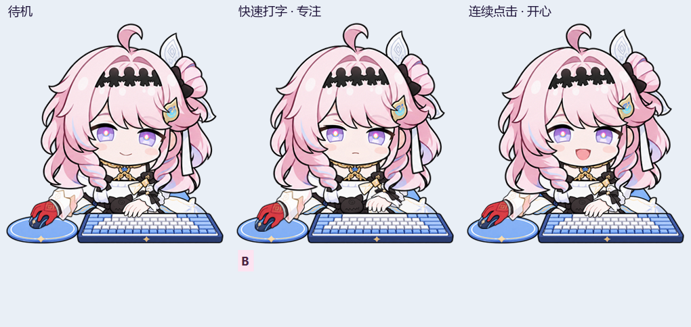

# 达妮娅 Windows 桌宠

一个以达妮娅 Q 版形象为主题的 Windows 悬浮桌宠。当前版本 **v18**，使用 C# / WinForms、Raw Input 与透明分层窗口。



## 下载与运行

从 [Releases](https://github.com/maxwu2579/denia-desktop-pet/releases) 下载 `DeniaDesktopPet-v18-Windows-x64.zip`，解压后运行 `DeniaPet.exe`，保留旁边的 `assets` 文件夹。支持 Windows x64，需 .NET Framework 4.x。

升级前从系统托盘退出旧版。若启用了登录启动，换到新文件夹后，在设置中重新应用该开关以更新路径。

## 功能

- 全局键鼠联动：多键高亮、左右中键与滚轮反馈，鼠标位于角色左侧。
- 可调整角色大小、提示字号和鼠标灵敏度，保存位置与设置。
- 鼠标穿透、位置锁定、暂停动画、手动隐藏和同屏全屏自动隐藏。
- 临时隐藏 15 / 30 / 60 分钟，可提前结束；手动隐藏和全屏状态优先。
- 提示文字支持始终显示、按键时显示和隐藏；按键模式松开后约 1 秒淡出。
- 快速打字进入专注表情，连续点击短暂开心，平滑恢复待机。
- 可选择登录 Windows 后启动，默认关闭。
- 待机降低刷新频率，隐藏或暂停时停止绘制。

右键托盘打开设置；双击托盘尝试显示桌宠，仍遵守全屏隐藏。穿透开启后，从托盘调整设置。

临时隐藏只对本次运行有效，退出后取消；选择“手动隐藏”会取消定时恢复。到期仍处于全屏时继续隐藏。

## 从源码构建

在 Windows PowerShell 中运行：

```powershell
.\build.ps1
.\dist\DeniaPet.exe
```

使用 Windows 自带的 .NET Framework 4.x C# 编译器，不需要 NuGet 包。输出位于 `dist/`，源码位于 `src/`，图像位于 `assets/`。

## 验证

```powershell
.\test.ps1
.\test.ps1 -WindowSmoke
```

第一条执行输入、布局、表情、设置、临时隐藏和启动项等测试。启动项测试只写入隔离的非 Run 注册表键，并清理自身测试键。

第二条额外运行实际窗口测试，会短暂显示测试窗口。使用测试配置与独立实例，不覆盖个人设置，不启用真实开机启动。输出在 `artifacts/` 和 `dist/`，不提交到仓库。

v18 的分项策略、输入、表情、布局和窗口检查已在开发环境验证。整理后的源码成功编译；完整 `test.ps1` 在当前机器上被 Windows 应用程序控制策略阻止执行新的测试程序，未完成整套脚本复跑。Release 使用此前已通过运行验证的 v18 可执行文件。

临时隐藏的真实定时器检查使用缩短为 1.5 秒的测试期限。全屏、锁屏、睡眠恢复的部分检查采用状态注入，实际游戏、真实锁屏及多显示器仍需试用。超长组合键首次可能扩展文字画布，之后不随释放缩回。

## 本地配置

配置保存在 `%LOCALAPPDATA%/DeniaDesktopPet/settings.xml`。仅在用户开启登录启动后，设置当前用户 `Run` 下的 `DeniaDesktopPet` 项；关闭时只移除此项。

程序不联网，不保存按键历史，不包含音乐。短时间按下计数用于表情反馈。

## 项目与素材

这是非官方同人桌宠，素材含 AI 生成内容，详见 [ASSETS.md](ASSETS.md)。参考 BongoCat 的键鼠互动形式；仓库未包含第三方 BongoCat 项目源码。当前未添加开源许可证。
